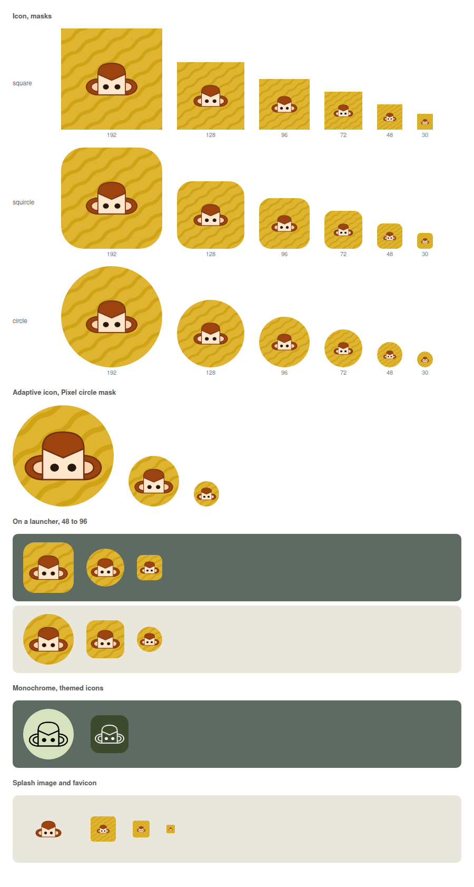

# App icon: a white tick on flat matcha

- **Status:** accepted
- **Date:** 2026-11-18

## Context

The app shipped with the Expo starter icon. The drawing is a blue "A"
over guide circles. Every new Expo project starts with it, so the app
looked like a starter project on the home screen.

Android 8 and later draw the launcher icon through a mask. The phone
maker picks the mask. A Pixel uses a circle. Many other phones use a
squircle. The icon must read inside each one. It also serves as the
browser favicon, which can be 30 pixels wide.

The operator reviewed a set of concepts on 2026-11-18. The goal was an
icon that reads as a task app at a glance and holds up at small sizes.
The operator rejected gradients, rounder shapes and other colours.

## Decision

The icon is a flat matcha square with one bold white tick. The matcha
is `#7A9A3E`. The tick is a polygon with a 12 wide round-joined stroke,
so its corners soften a little. Nothing else sits on the tile. The tile
has no gradient and no shadow.

The tick spans 64% of the tile's width. It reads at 30 pixels, and the
air around it keeps the tile calm. The tile's own corners round by 12.5%
of the side. Only the splash image and the favicon draw that corner.
The launcher icon is full bleed, so each phone adds its own mask.

Android uses a two layer adaptive icon. The flat colour is the
background layer. The tick alone is the foreground, at 64% of the
visible circle. It then weighs the same on the home screen as on a
plain square. The whole tick sits inside the 66 of 108 safe circle, so
no mask clips it. Themed icons reuse the tick as the monochrome layer.

Rejected concepts:
- A gradient brush tick: the shading turns to mud at 48 px.
- A ring around the tick: it crowds the mask edge.
- A tick over a list: the list lines blur at 48 px.
- A monkey face: it reads as a brand joke, not a task app.
- Monkey-budget style petals: too busy for a small tile.
- A ticked box: the box edge doubles the tick's weight.
- A tick breaking out of a box: the break reads as damage.
- Deep green: too dark beside a dark wallpaper.
- Leaf green: too yellow, so the white tick loses contrast.
- Ink: the tile reads as a tool, not a task list.
- Light matcha: the white tick fades on a pale tile.
- Deep matcha: it reads as black at 30 px.

We keep the sources, not just the PNGs. `app/scripts/app-icon/source/`
holds four SVG files. `npm run app-icon:build` rasterizes them with the
Chromium that Playwright already installs. A test fails when `app.json`
and the source disagree on the colour. It also fails when the tick
leaves the safe circle, or when an asset has the wrong size.

## Consequences

A colour or shape change is one edit to a source and one command. The
PNGs stay in step with the drawing, and a reviewer can rerun the build.

The icon is one flat colour by design. A richer drawing would need a
new decision, not a small edit. The tick keeps its size and its place,
because the adaptive layers and the square icon share the same drawing.

The splash image and favicon now match the launcher icon. A phone that
caches a launcher icon may show the old one until its cache clears.

## Amendment, 2026-11-24: the monkey

The operator drew a monkey face on paper and picked it as the mark. The
matcha tick retires. The drawing lives in
`app/scripts/app-icon/monkey.ts`, so one file still produces every asset.

The mark is a bookmark turned over. The face is a rectangle with a V cut
into its top. A domed fur cap fills the V. Two dot eyes sit below it.
Oval ears with inner ears sit behind the head. A thin brown line outlines
every shape.

The palette is Flexoki only:
- Face orange-50 `#FFE7CE`, inner ear orange-100 `#FED3AF`.
- Fur orange-700 `#9D4310`, outline orange-800 `#71320D`.
- Eyes orange-950 `#27180E`.
- Tile yellow-300 `#DFB431`, waves yellow-400 `#D0A215`.

The tile carries soft diagonal waves in the second yellow. The line is
3.6 units wide on the 108 tile. Lines sit 15 apart, turned 35 degrees.

The mark is 54 of the 108 tile, so it fills 75 per cent of the visible
circle. Its outline reaches 32.3 of the 33 safe radius. The themed layer
is the line drawing alone, at 6 units, and the ear lines hide behind the
head.

The splash is new. `expo-splash-screen` draws the mark on the tile
yellow, 200 wide. Before this, the app had no splash image. The adaptive
icon and the splash take their background from the same palette.

Rejected:
- Vines behind the mark: too busy at 48 px.
- The filled style: the flat cap loses the dome.
- Gradients: they turn to mud at 30 px.
- The green, deep and brown tiles: the banana one reads best.
- A bare mark on the wallpaper: it has no ground of its own.

The sources are TypeScript now. We deleted the four SVG files. A test
still guards the tile colour in `app.json`, the splash colour, the safe
circle and the asset sizes. It also checks that the square tile stays
full bleed.
