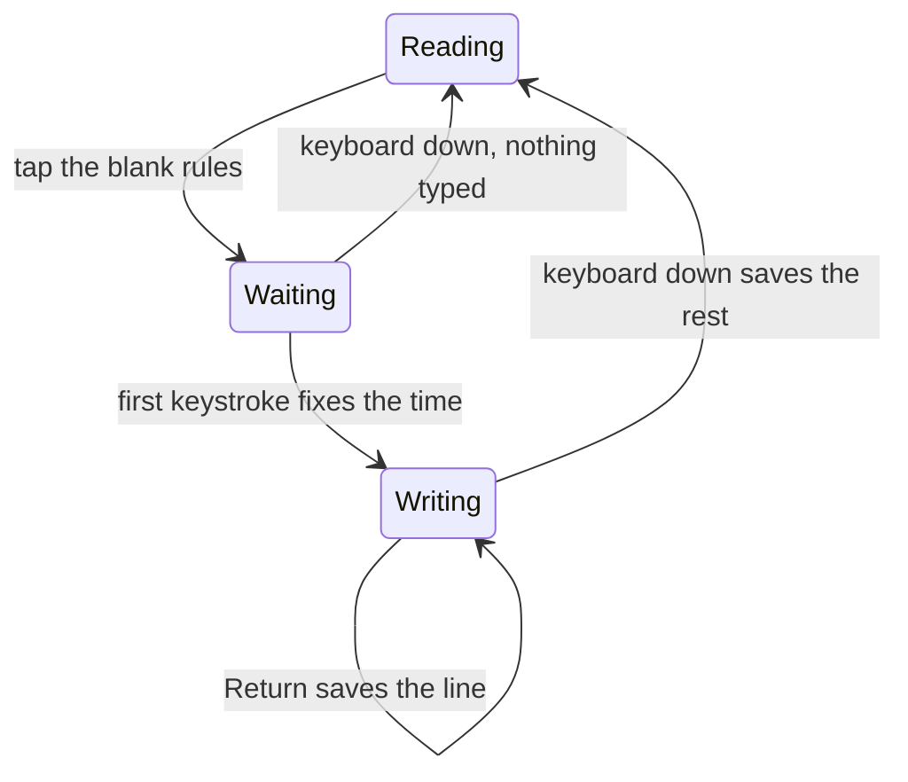

# The Journal tab: tap the page to write

- **Status:** accepted
- **Date:** 2026-11-27

## Context

Today a journal entry takes three steps. Add opens a sheet. You type,
then Send writes one block, stamped with the minute you sent it. A Food
chip turns each line into `Ate: ... #food`. The app only appends, so a
typo gets fixed in Obsidian (ADR 20261112-journal-format).

On 2026-11-26 the operator asked for a page you write on directly. A
tap on the page raises the keyboard, and the bottom line waits with a
time on its left. Add gets a new job on this tab. On 2026-11-27 they
added two asks. Done tasks show on the page as a log. Typing `@` finds
a reference. We settled the design with the operator that day, from
frames at phone width. Ticket `20261126-journal-tap-to-write` holds
the request.

The block format does not change. A block is still one `HH:MM` line
with `- ` bullets under it.

## Decision

**Tap to write.** A tap on the blank rules below the last block raises
the keyboard. The caret sits on a new bottom line. The first empty rule
shows a faint "Tap to write" hint.

**One time per writing session.** The rail shows the live clock in the
accent color until you type. Your first keystroke fixes the time.
Return adds a bullet under the same time. A tap with no typing writes
nothing.

**The keyboard going down ends the session.** Back, a tap outside the
page, or a tab switch all end it. You never press Send. Each Return
saves its line, and the keyboard going down saves the rest. A crash
loses one line at most. The next tap starts a new time.

**Tap an older line to edit it.** The caret lands where you tapped.
Empty a line and leave it to delete that bullet. A block that loses its
last bullet loses its time line too. Return inside an older line adds a
bullet to that block, and the block keeps its time.

**The app now rewrites lines.** It changes only the lines you touched
and keeps every other byte. The task writes already work this way. If
Obsidian changed the note since the app read it, the write stops. The
page reads the note again, and your text stays for a retry.

**`@` finds a reference.** Type `@oat` and a list of `References/`
notes shows above the keyboard. It matches on the note's name and
shows five at most. A pick replaces `@oat` with `[[oatmeal]]`. With no
match, the text stays as typed. The list never creates a note. A tap
on a link still opens the reference sheet.

**Food comes from the reference.** A line that links a food reference
is food. You type no marker. On save the app adds `#food` to the line
when the line lacks it, so Obsidian search finds it too. The parser and the
header count still read `#food`. A line with no food link is not food,
so "a banana" counts only once a banana note exists. The food
check runs at save time. Changing a reference later leaves old lines
as they are.

A reference counts as food when its `types` holds `[[foods]]`. The
contract names `types` as the field for what sort a reference is. The
sample vault uses `kind: "[[foods]]"` instead, which the contract does
not know. The build checks the real vault before it fixes this rule.

`Ate:` goes away for new lines. Old lines keep their `Ate` label, and
their `#food` still counts.

**Add on this tab opens the `@` list.** The Food chip goes away with
the sheet. Add starts a new session with `@` already typed, so the
reference list shows at once. While you type, the keyboard covers Add,
so you type `@` yourself.

**Done tasks show on the page, read live.** The page reads today's
ticked tasks from their notes. It writes nothing into the daily note. A
task ticked in the app saves the time in `completed`, so it sits in
the timeline at that time. It shows muted, with a check. A task ticked
in Obsidian may hold only a date. Those sit in one "Done today" group
under the day's title. A tap on a done task opens it in the task
editor. An untick removes it from the page.

**Two smaller choices, made without the operator.** A session that
runs past midnight stays in the day it started. A tap on a blank rule
while you write moves the caret to the bottom line.

We rejected these options:

- A time on every line. It fills the rail and splits one thought into
  many blocks.
- Merging a tap into the last block within five minutes. Nobody
  sees the rule, so the page is hard to predict.
- A Done button with a draft. It adds a tap, and drafts that never
  land get lost.
- A long-press menu to edit. It hides a common action.
- Keeping the app add-only. A typo still means a trip to Obsidian.
- The bar riding above the keyboard. It costs a row of writing space.
- An Ate pill on the current line. That adds a control to learn.
- `@food` as the food marker. Obsidian does not index `@`, so its tag
  search and Bases would miss it.
- A typed `#food` as well as the reference. The operator wants one
  rule: food is what links a food note.
- Writing done tasks into the daily note as `- [x]` lines. A copy goes
  stale when you untick a task.

## Consequences

Writing takes one tap. A typo gets fixed where it sits. The block
format stays the same, so old notes and Obsidian need no change. Food
gets logged by linking what you ate, which also builds the links a
later calorie count needs.

The app now rewrites a journal note, not just appends to it. A bug can
damage a note. The line rules need tests for every edit, and the
change check guards each write. A keyboard closed by accident saves a
half-written line. You fix it with a tap.

Food without a reference note is not counted. Logging a new food means
making its note first, in Obsidian for now. The Journal now reads task
notes, so it no longer stands apart from the task store. The done log
shows only in the app, because the daily note holds no copy.

This supersedes the composer sheet, the Food chip, the `Ate:` prefix
and the add-only rule in ADR 20261112-journal-format. That record gets
an amendment pointing here.
